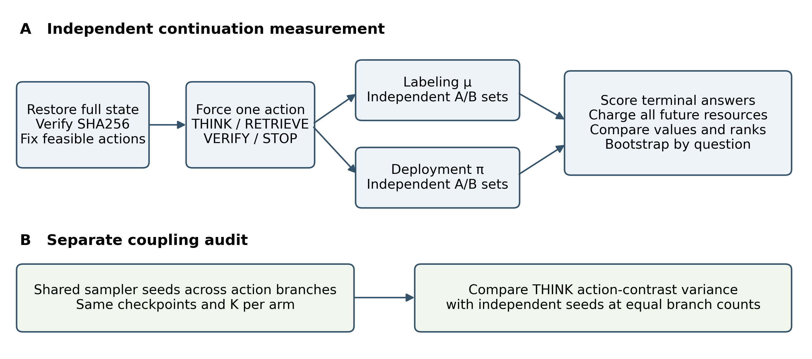
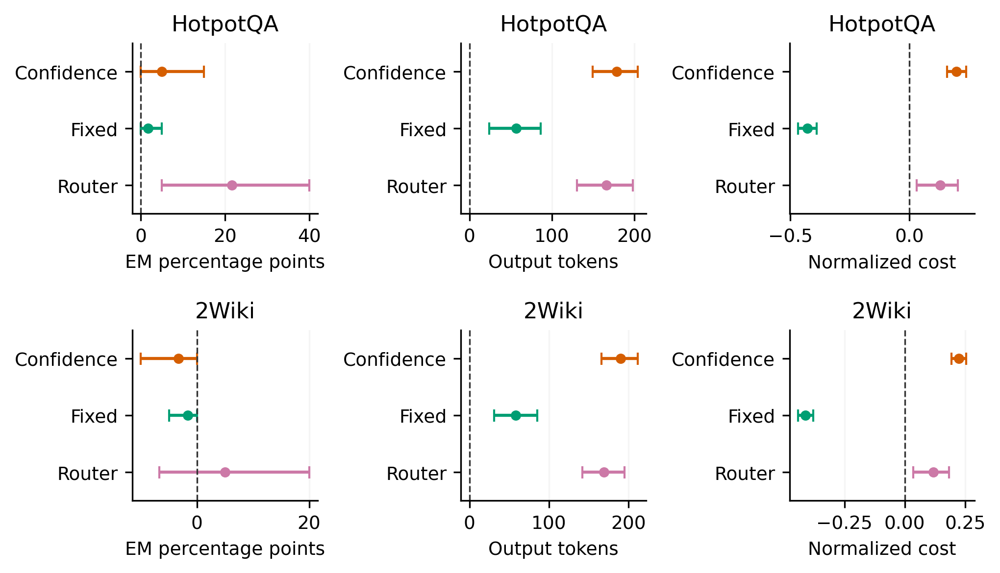

# CRAVE Counterfactual Value Learning for Budgeted Language Model Agents

CRAVE learns policy-conditioned values for THINK, RETRIEVE, VERIFY, and STOP using matched interventions from identical saved states. A frozen encoder and a small multilayer perceptron predict utility, success, future resource costs, and auxiliary ordered interactions. A feasibility mask enforces output-token and tool limits.

[Verified MIVE revision (Word)](MIVE_Verified_Manuscript.docx) · [35 references](manuscript/REFERENCES_MIVE.md) · [Revision and reviewer concern map](experiments/mive_revision/revision_summary.md) · [Numerical archive](MIVE_Verified_Revision_Archive.zip)

The revised manuscript reports the observed legacy allocation failure and a fresh development audit of labeling versus deployment continuations. It separates continuation discrepancy from sampling noise and compares matched sampler seeds with independent seeds at equal branch budgets. Its primary and resource-priced analyses retain failed stability gates and null findings. See the [audit runbook](experiments/mive_revision/README.md), [experiment register](experiments/mive_revision/experiment_register.csv), and [unsupported claims](experiments/mive_revision/unsupported_claims.json). The 1.5B and 7B development checks test execution and accounting; they are not powered efficacy comparisons. The requested three-dataset scaled held-out study, published-method reproductions, and MIVE ablations remain incomplete.

[Earlier CRAVE manuscript](CRAVE_Full_Manuscript.docx) · [Earlier reference list](manuscript/REFERENCES.md)

## Experimental evidence

Training used four questions. The original feasibility pilot evaluated six questions, three seeds, and nine method labels (162 episodes). The subsequent frozen-controller test evaluated 40 fresh questions, three seeds, and four methods (480 episodes). The expanded sample was selected after the pilot from bounded public record pools and used a shared 687-passage transductive corpus.

| Expanded test | CRAVE EM | Confidence EM | CRAVE output tokens | Confidence output tokens |
|---|---:|---:|---:|---:|
| HotpotQA, 20 questions | 55.0% | 50.0% | 229.5 | 51.2 |
| 2Wiki, 20 questions | 43.3% | 46.7% | 249.7 | 60.1 |

No observed efficiency advantage over confidence was established. Paired accuracy differences were not significant after Holm correction. Output-token cost increased consistently. Full-benchmark superiority, calibrated uncertainty, unseen-budget generalization, and cross-model transfer remain unestablished.





Seven figures cover the workflow, task-level quality and cost, per-question paired costs, action frequencies, cost components, paired effect intervals, and sensitivity to individual questions. PNG and vector PDF versions are included.

The comprehensive local audit recomputed 642 answer-score and episode-counter records, 296 summary metrics with intervals, 46 paired comparisons, 192 branch payloads, 1080 model predictions, 90 diagnostic cells, and 22 retrieval-support records. Its machine-readable report is in `tmp/full_manuscript_assets/comprehensive_result_audit.json`. Model predictions matched within a maximum absolute float32 discrepancy of 2.384e-7. This reconstructs retained outputs; stochastic language-model generation was not rerun.

## Install and verify

Run from this repository root with Python 3.11 or newer. Original experiments used Python 3.12.14 on Windows and an RTX 3060 Laptop GPU with 6 GB memory.

```sh
python -m venv .venv
# Windows: .venv/Scripts/activate
# Linux or macOS: source .venv/bin/activate
python -m pip install -r requirements.txt
python -m unittest discover -s crave/tests -v
python analysis/verify_release.py
```

The verifier checks source and configuration hashes, numerical episode checksums, checkpoint hashes, task-seed-method pairing, budget bounds, action counters, cost components, summary means and intervals, paired estimates and intervals, raw permutation probabilities, and Holm corrections. Full answer-score and state-restoration audits require retained raw local records. With those records and encoder assets, `python tmp/audit_all_results.py` reconstructs the comprehensive audit.

## Rebuild figures and Word source

```sh
python tmp/expanded_figures.py
python tmp/scientific_figures.py
python tmp/journal_revision.py
python tmp/build_full_manuscript.py
```

The numerical release supports these commands without benchmark downloads or inference. Word equations remain editable. Rebuilding may change the layout across Word and LibreOffice versions; render and inspect it before submission.

## Run new experiments

```sh
python -m crave.scripts.prepare all
python -m crave.scripts.prepare_author_data
```

Preparation downloads pinned upstream assets and verifies digests. Model weights, encoder binaries, and llama.cpp binaries are not bundled. On Windows, inspect devices and use `crave/scripts/start_server.ps1`; the recorded setup used Vulkan1 and local port 8096. Other platforms require an equivalent local llama.cpp server and verified assets. Then run a new feasibility protocol:

```sh
python -m crave.pipeline --train-tasks 2 --eval-tasks 3 --budgets 1 --interaction-states 1
```

New inference produces a new configuration identity and does not establish exact reproduction of the original machine's latency. The byte-identical expanded runner in `tmp/expanded_evaluation.py` retains its original Windows base path as a provenance artifact. [The runbook](crave/RUNBOOK.md) records the executor and unexecuted full-study requirements.

## Release contents

- `crave/`: executed Python source, configurations, tests, and preparation code.
- `crave/runs/bdd2b8a990571bb1/`: pilot numerical results and three frozen CRAVE checkpoints.
- `crave/runs/expanded_8484164aef776a12/`: expanded numerical episodes, summary tables, paired statistics, and audit reports.
- `tmp/`: manuscript and figure builders and figure assets.
- `analysis/`: verifier and file checksum manifest.

Published episode JSON and per-instance CSV omit answer text, questions, summaries, prompts, and benchmark passages. JSON identifies this transformation and carries a separate numerical-data checksum. Raw dataset exports, downloaded papers, unrelated files, inference caches, environments, pretrained models, and vendor binaries are excluded. Upstream datasets and models retain their licenses; the unresolved raw 2Wiki export license is not treated as permission to redistribute passages. No software license grant has been selected.

Author information in the revision is retained from the supplied manuscript; funding and competing-interest declarations require author confirmation. No Zenodo DOI exists. Audit success establishes correspondence to the executed protocol, not completion of the broader research study. Four training questions and a post-pilot 40-question test do not establish broad superiority or certify readiness for a Q1 journal. See [submission readiness](manuscript/SUBMISSION_READINESS.md).
